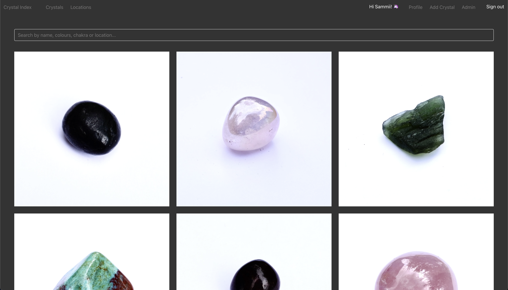

# Crystal Index

[crystalindex.co.uk](https://crystalindex.co.uk)

A crystal directory and collection app built with Next.js and Prisma. Browse crystals by name, colour, hardness, chakra, zodiac sign and element, read detailed properties and care guides, and identify crystals from a photo in the iOS app.

Each crystal can be linked to locations by origin or by where it was bought as a memento, and those locations are shown on an interactive React Three Fiber globe.



## Stack

- Next.js (App Router and Pages Router)
- TypeScript
- Prisma with PostgreSQL
- Vercel Blob for crystal images
- NextAuth
- React Three Fiber

## Development

Uses pnpm (see `packageManager` in `package.json`) and Node 24.

```bash
pnpm install
pnpm dev
```

- `pnpm test` runs the icon checks, the catalogue tests and Jest
- `pnpm test:catalogue` runs the directory filter and gallery tests on their own
- `pnpm lint` runs the icon checks and Next lint
